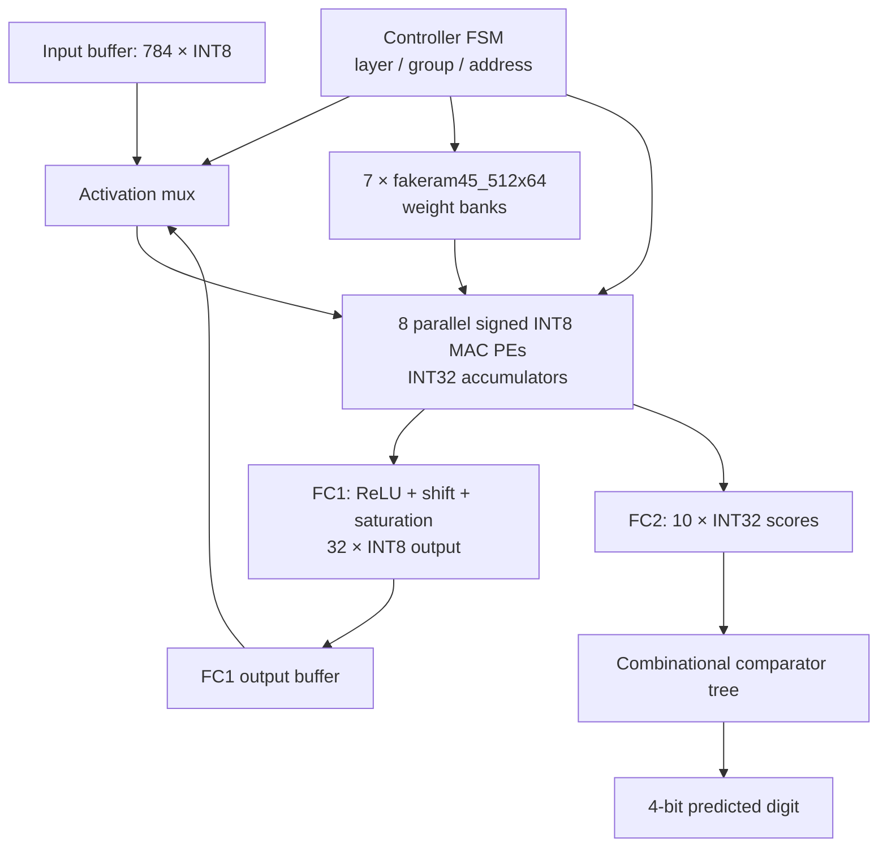

# MNIST-NPU | INT8 MLP Accelerator — RTL to GDSII

**8-PE Output-Stationary NPU · 784–32–10 MNIST MLP · Nangate45 / OpenROAD Flow Scripts**

This repository implements a two-layer, INT8 multiply-accumulate (MAC) accelerator and documents its physical-design experiments. The emphasis is not only on GDS generation, but on **5 ns timing closure, hard-SRAM integration, and measurable PPA trade-offs**.

> **Evidence boundary:** The numbers below come from committed simulation logs and post-route OpenROAD reports. They are **not** claims of tape-out readiness, independent signoff DRC, formal equivalence, or reproduced 1,000-image simulation.

## 1. Project objectives

| Requirement | Target | Evidence / status |
| --- | --- | --- |
| Network | 784 → 32 → 10, two fully connected layers | `rtl/npu_top.sv` |
| Arithmetic | Signed INT8 operands, 8 shared PEs, INT32 accumulators | `rtl/pe.sv`, `rtl/pe_array.sv` |
| Weight storage | 7 × 512×64-bit hard SRAM macros | `rtl/weight_memory.sv`; synthesis/placement logs |
| Technology | Nangate45, OpenROAD Flow Scripts | `physical_design/designs/nangate45/mnist_npu/config.mk` |
| Timing constraint | 5.0 ns (200 MHz), setup/hold TNS = 0 | `constraint.sdc`; final reports |
| Routing | Detailed-router final violations = 0 | `final_5ns/5_2_route.log` |
| Optimization study | Maintain timing closure; reduce std-cell area toward ≤73,000 µm² | Experimental candidate recorded; equivalence pending |

The **≤73,000 µm²** standard-cell area is a proposed portfolio optimization objective, **not** an original design requirement. The baseline timing target is 5 ns.

## 2. Architecture



- **FC1:** 784 input values × 32 outputs, processed in four groups of eight output neurons.
- **FC2:** 32 inputs × 10 outputs, processed in two groups with the same eight PEs.
- **Weight SRAM:** 3 macros in the left column (MY) and 4 in the right column (R0) in the documented manual macro floorplan.
- **Input buffer:** RTL array implemented separately from the seven weight hard macros.
- **Argmax:** combinational four-level comparison tree; not a four-cycle pipeline.

See [Architecture and memory map](docs/architecture.md).

## 3. Functional verification (committed evidence)

| Test | Recorded result |
| --- | --- |
| Weight SRAM write checks | PASS (representative bank addresses) |
| Image loading | PASS for 100 images, 784 pixels per image |
| RTL vs Python golden model | 0 mismatches across 100 tested images |
| RTL MNIST accuracy | **98/100 = 98.00%** |
| Python model accuracy on same samples | **98/100 = 98.00%** |

Evidence: [`simulation.log`](simulation.log) and [testbench](tb/tb_npu_mnist_extended.sv). The testbench supports 100 or 1,000 samples, but only a **100-sample completed run** is evidenced in the committed log. The repository currently does not contain all files needed to rerun it; see [Verification](docs/verification.md).

## 4. Physical-design results (post-route)

Metrics are from `physical_design/logs/nangate45/mnist_npu/<run>/6_report.json`. WNS is positive when the corresponding check has margin. Standard-cell area excludes SRAM macro area.

| Run | Setup WNS | Hold WNS | Setup / hold TNS | Std-cell area | Max-cap violations |
| --- | ---: | ---: | ---: | ---: | ---: |
| `5ns` (initial) | −0.835 ns | −0.00262 ns | −3.313 / −0.00262 ns | 76,799 µm² | 10 |
| `final_5ns` (timing-closed baseline) | **+0.656 ns** | **+0.00168 ns** | 0 / 0 ns | 76,557 µm² | 0 |
| `exp_arith_tree` | +0.780 ns | +0.00388 ns | 0 / 0 ns | 72,458 µm² | 0 |
| `exp_arith_tree_ks` (optimization candidate) | **+0.801 ns** | **+0.00172 ns** | 0 / 0 ns | **72,005 µm²** | 0 |

The reported area difference between `final_5ns` and `exp_arith_tree_ks` is **−5.95%** for standard cells; setup WNS differs by **+0.145 ns**. This is a comparison of *recorded runs*, not an isolated proof that one algorithm caused the difference. Reproducing the precise RTL/options and validating functional equivalence are next steps.

[Read detailed timing/PPA analysis](docs/timing_ppa.md) · [Physical design & macro methodology](docs/physical_design.md)

### Visual evidence

[Final placement](physical_design/reports/nangate45/mnist_npu/final_5ns/final_placement.webp.png) ·
[Final routing](physical_design/reports/nangate45/mnist_npu/final_5ns/final_routing.webp.png) ·
[Worst path](physical_design/reports/nangate45/mnist_npu/final_5ns/final_worst_path.webp.png) ·
[Congestion](physical_design/reports/nangate45/mnist_npu/final_5ns/final_congestion.webp.png)

## 5. Repository navigation

| Path | Contents |
| --- | --- |
| [`rtl/`](rtl/) | Synthesizable accelerator RTL plus behavioral SRAM simulation model |
| [`tb/`](tb/) | MNIST testbench and golden-model comparisons |
| [`data/`](data/) | Committed FC1 expected-output samples; incomplete test-vector set |
| [`physical_design/designs/`](physical_design/designs/) | Nangate45 ORFS config, 5ns SDC, macro and I/O placement |
| [`physical_design/logs/`](physical_design/logs/) | Individual experiments and per-stage reports |
| [`physical_design/results/`](physical_design/results/) | Existing ODB, DEF, netlist, GDS, SPEF outputs |
| [`docs/`](docs/) | Architecture, verification, PnR, timing/PPA and reproducibility notes |
| [`scripts/`](scripts/) | Local-only report comparison and missing-input checks |

## 6. Reproduce or audit the evidence

```bash
# Run on a local clone; Python 3 standard library only
python3 scripts/compare_ppa.py
python3 scripts/compare_ppa.py --all --format csv
python3 scripts/check_inputs.py --data-dir data --samples 100
```

The last check is **expected to report missing files** with the current public repository. This is intentional and makes the reproducibility gap explicit. See [Reproducibility checklist](docs/reproducibility.md) before attempting a clean simulation or a fresh physical-design run.

## 7. Current limitations and next milestones

1. Record the RTL revision, configuration, macro/Liberty versions, tool commit, and inputs for *each* experiment.
2. Restore the complete licensed/shareable MNIST input, weight and golden-model generation workflow; rerun 100 and 1,000 samples.
3. Confirm baseline-versus-optimization **functional equivalence** before attributing PPA improvements.
4. Audit unconstrained paths, reset checks, hard-macro timing, and SDC I/O assumptions.
5. Run independent signoff DRC and appropriate LVS/LEC checks. Router DRC = 0 alone is not signoff.
6. Treat reported power as tool-estimated power until actual activity assumptions are documented.

[Detailed verification checklist](docs/verification.md) · [Experimental protocol](docs/reproducibility.md)
